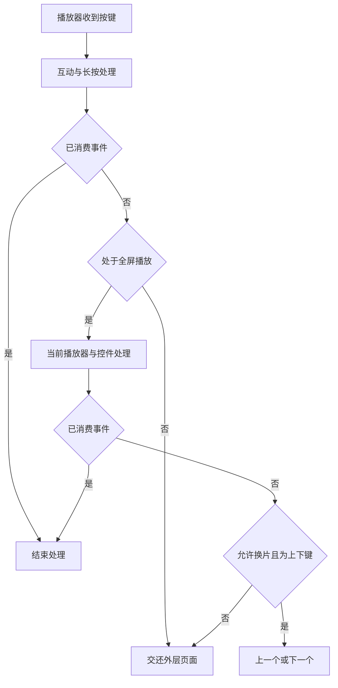

# 云视听小电视 1.8.9 静态交互分析

## 结论与分析方式

这份 APK 能在不启动应用的情况下，分析部分交互规则。已确认：菜单按播放场景组织；搜索页分区处理按键；播放器先让当前控件消费事件；长按确认包含临时 2 倍速和一键三连分支；画质与播放方式存在持久偏好。

这些是静态代码和配置证据，不能替代运行测试。没有取得首页截图、实际按键次数、响应时间或焦点恢复结果。此前六条运行路径仍为“阻塞”，但本轮已取得相关路径的静态分析结果。

输入是用户提供的 `~/Downloads/iBiliTV-master.apk`，版本为 1.8.9（108900）。SHA-256 为 `73229ae195f45cdbfd4577b81962a4b4c9345a36abcd846e00dbc0647c127ef2`，与前次官方下载文件一致。环境与兼容性见[兼容性核查报告](云视听小电视-兼容性核查与补测清单.md)。

本轮使用 [JADX 1.5.6 官方发行版](https://github.com/skylot/jadx/releases/tag/v1.5.6)，发行包 SHA-256 为 `545ea2be9c242511bc145755cf4bda2485ade42966e096f8b4d3da2a230e8974`。工具只放在本次临时目录。处理了 7 个 DEX；完整反编译退出码为 3，报告 140 处错误，不能声称完整恢复源代码。另用 simple 模式检查播放控制方法，并用 Android SDK 的 `dexdump` 核对临时倍速的设置与恢复指令。

可检查的片段、源文件哈希和菜单摘录保存在[静态交互证据 JSON](evidence/云视听小电视-1.8.9-静态交互证据.json)。下文的 E01～E22 对应该文件的 `evidence[].id`。文件路径是反编译输出中的路径；行号只适用于这次输出。完整拆包目录为 `/private/tmp/bili-tv-static-wd9hxul1/`，属于临时产物；报告与精选证据保存在仓库。

## 六条路径能还原到哪里

### 首页与分区：焦点有明确的区域归属

`MainActivity.__Ghost$Origin$dispatchKeyEvent()` 先检查启动页面，再让广告、顶部气泡和当前内容 Fragment 依次处理事件。上层处理后返回 `true`，后面的通用导航就不再执行。依据：E02。

`MainFragment.e2()` 判断焦点是否位于频道标题栏，并排除 `region-management`；`f2()` 判断顶部气泡是否有焦点。主 Activity 据此处理上下键，而非只用全局几何距离寻找下一个元素。依据：E03。

- 标题栏按下：向当前内容页请求 `getRequestFocus()`；失败时调用标题栏反馈，不直接假定首张卡片可用。
- 顶部气泡按下：调用 `go2Title()` 回到标题区域。
- 内容区按返回：存在调用当前页 `go2Top()` 并消费事件的分支。
- 分区管理入口：有单独的焦点标签和边界反馈分支。

这能证明“顶部入口、频道标题、内容区”采用不同导航规则。不能据此确定当前首页的频道顺序、推荐内容、每屏卡片数或初始焦点。主 Activity 的 `onBackPressed()` 未恢复成可信的结构化 Java，完整退出条件保留为未知，不能把它简化成固定的“两次返回退出”。依据：E21。

### 搜索：返回键按当前区域处理

搜索页面存在键盘、默认推荐区和结果区三个协作组件：`SearchKeyboardView`、`SearchDefaultFragment` 和 `SearchResultHostFragment`。`SearchActivity.s()` 包含从键盘转入推荐区、从推荐区转入结果区的分支，是否可转入取决于目标组件当前是否有可用内容。依据：E04。

返回键也按区域处理：结果区先获得处理机会；推荐区存在返回键盘的分支；焦点在键盘且输入非空时，调用 `C0()`，最终执行键盘的 `t()` 清空输入，并消费这次按键。由此可确认，返回键可能先清输入，并不总是退出搜索页。依据：E04、E05。

键盘还包含显式调用系统输入法的点击处理。它支持自带输入组件和系统键盘入口，但中文候选显示、拼音输入效率和设备输入法兼容性都未运行验证。依据：E05。

### 详情与播放：入口和布局受类型控制

Manifest 声明了 `videodetail.VideoPlayActivity`。其 `inFullPlay()` 返回内部状态 `!this.g`；详情布局另有按内容类型和页面样式选择的分支。不能将所有视频入口描述为固定的“卡片 → 独立详情页 → 播放”。依据：E22。

`assets/top_group_button.json` 按 `play_type` 提供 5 组按钮配置，包括“全屏观看”“视频详情”“追番/追剧/追更”“全部作品”等。“全屏观看”的 `auto_focused` 在这些本地配置中为 `true`。`video/unite/d.e0()` 确实读取该文件。依据：E18 和证据 JSON 的 `selected_local_top_buttons`。

这里的 `auto_focused` 只是本地配置声明。尚未沿所有按钮构建与远程覆盖分支验证它最终生效，不能写成“实测进入详情默认聚焦全屏观看”。

### 播放设置：菜单与控件分层

APK 打包了 39 组场景菜单。菜单管理器受 `is_menu_use_api` 和 `is_menu_use_remote_config` 控制，可请求接口、读取远程 JSON，或回退到本地 `menu_v2_default.json`。接口成功后会更新菜单并发送变更事件。依据：E01。

以下是本地菜单声明，不是线上界面的完整功能清单：

| 场景 | 本地入口举例 | 二级选项举例 |
|---|---|---|
| `ugc_view` | 点赞、收藏、设置、简介、UP 主、选集/合集 | 倍速、清晰度、播放方式、更多 |
| `feed_ugc` | 更多作品、点赞、不感兴趣、收藏、设置 | 0.5～2.0 倍速、清晰度、自动连播、单集循环 |
| `common_ugc` | 更多作品、点赞、收藏、设置 | 弹幕速度、字号、不透明度、区域、记忆开关 |
| `detail_common_v159_ugc` | 关闭、交互操作、下一个、倍速、清晰度、设置 | 长按确认效果、音量均衡、弹幕设置、线路、更多 |
| `child_view` | 收藏、不感兴趣、清晰度、听视频 | 自动连播、底部推荐内容、问题反馈 |

新版场景的弹幕项还声明“底部字幕区域防挡”；长按确认效果声明“二倍速”和“一键三连”。菜单里出现杜比或其他播放能力，只能证明有相关入口声明，不能证明当前设备支持或当前内容具备该能力。

菜单还会按运行状态过滤。`MenuSettingWidgetForDecoupling` 检查 `InteractionDolby.danmukuButton`；未明确为 `true` 时，会移除弹幕设置入口。因此，静态资源中有某项，不代表用户一定看得到。依据：E11。

设置控件处理返回时，若弹幕子面板打开，会先隐藏弹幕设置并恢复菜单层；另有隐藏子列表、恢复主列表和标题的分支。它处理上下左右、确认和返回的方式有别于外层播放页。依据：E11。

### 历史续播：选择集数，再选择进度来源

`PlayHistoryReader.getEpPair()` 使用已保存的内容索引匹配 cid；`readServer()` 将服务器 `WatchProgress.videoId` 映射回当前集列表的位置。返回结果包含集索引和进度，而不只是一个时间戳。依据：E16 所引用的类及方法。

`readHistory()` 先处理特定内容来源的缓存，再尝试服务端进度；满足未登录及相关配置条件时，才有进一步读取本地记录的分支。不能概括成“始终本地优先”或“始终云端优先”。依据：E16。

新版历史列表的 `requestDefaultFocus()` 存在聚焦第一个完整可见条目的分支。这能说明默认焦点的选择策略，不能证明从播放器返回时一定恢复到原卡片。播放位置、分 P 和列表焦点需要分别验收。依据：E17。

## 遥控器规则：同一个键随状态改变含义

播放器的处理顺序可以从委派代码中还原为：先处理互动/长按等情况，再检查全屏状态，让实际播放器及当前控件处理；未消费且未禁止换片时，才进入上下切换的回退逻辑。依据：E06。

这张图省略日志和具体互动子状态，不能用来替代每个场景的完整状态机。

| 输入 | 静态确认的规则 | 限制 |
|---|---|---|
| 上 / 下 | 在委派层的回退分支中，上键调用 `switchPrev()`，下键调用 `switchNext()`；按下后设状态位，抬起再恢复，抑制按住时重复切换 | 当前播放器、菜单或进度条可以先消费事件；不能称为全场景固定换片键 |
| 短按确认 | 控制代理按控件是否展示、焦点是否在菜单等状态，进入播放控制或执行菜单项；普通播放分支有暂停/恢复调用 | 播放状态、直播和其他控件会改变结果 |
| 长按确认 | 菜单值 `5801 → 1`，`5802 → 2`；偏好 `long_press_ok_action` 可持久保存 | 实验组、内容排除条件、是否正在播放、控制层是否可见均会影响实际动作 |
| 临时 2 倍速 | 先保存原速度，再调用 `setSpeed(2.0f, false)`；结束处理调用 `setSpeed(原速度, false)` | 已用 DEX 指令核对两个调用；未验证实际音画、松手时延或异常恢复 |
| 返回 / 菜单 | 控制代理包含关闭当前控制层、处理其他覆盖层或打开菜单的分支；设置面板优先处理自身子层 | 自动还原 Java 的部分分支出现不可信结构，已用 simple 输出核查共用入口，完整退出优先级仍待运行验证 |
| 左 / 右 | 进度条有独立 `onKeyDown/onKeyUp`，菜单与顶部按钮也有独立焦点判断 | 未据此认定左右键永远快进或快退 |

长按检测使用 `ViewConfiguration.getLongPressTimeout()`，不能写成跨设备固定的 500 ms。临时倍速和长按菜单映射分别见 E07～E10；播放控制区域判定及开关入口见 E19、E20。

## 偏好与反馈：声明、状态和结果分别处理

画质服务保存用户期望值，并分别持久化点播画质和直播画质，随后调用播放器换档。该顺序证明存在用户偏好，但不证明换档失败时的全部回滚语义；本轮没有完整还原复杂画质错误处理。依据：E14。

播放方式的选项 ID 映射为 `2501 → 0`、`2502 → 1`、`2503 → 2`。本地选定场景提供自动连播和单集循环；选择代码先判断是否与当前策略相同，再保存 `play_loop_strategy` 并更新播放器完成动作。不能把代码支持的所有策略都当成当前菜单可见项。依据：E12、E13。

弹幕设置代码读取 `PREF_DANMAKU_SWITCH_SAVE` 和 `PREF_DANMAKU_BOTTOM_BLANK`，对应开关记忆和字幕区域留白。前者默认值还会参考配置；后者在该读取分支传入默认值 `true`。这是配置读取规则，不是本机用户实际设置。依据：E15。

## 对 bilibili-tizen 的借鉴与取舍

本节对照已指定的 `884fc92`，不使用工作树中的其他修改作为基线。`1601890` 的按钮文案差异已在兼容性报告中说明。以下建议尚未采纳或实施，成本只表示改动范围的初步判断。

| 顺序 | 候选方向 | 用户收益与成本判断 | 现有依据与取舍 |
|---|---|---|---|
| 1 | 按区域和覆盖层检查焦点、返回优先级 | 减少误退出和焦点丢失；核查成本低，修复成本取决于具体失败 | 官方有区域委派和多层返回。Tizen 已有 `Nav`、返回栈和 `closePlaybackChoices()`，优先验证已有规则，无须先换导航架构。 |
| 2 | 明确搜索返回的清输入与退页面语义 | 减少重新输入；涉及搜索状态和返回处理，成本中等 | 官方键盘非空时存在返回清空分支。该行为可能也让用户意外丢字，须与 Tizen 当前 `renderSearch()` 流程实测比较，不能直接照搬。 |
| 3 | 将弹幕防挡等常用参数放在观看时可达的位置 | 可能减少往返设置页；需要布局与字幕/弹幕覆盖回归，成本中等 | 官方声明弹幕独立设置层并读取字幕区域留白。Tizen 已有弹幕开关，不重复增加相同入口；是否补参数入口需用户确认。 |
| 4 | 全屏长按确认临时 2 倍速 | 可能减少短暂加速时的菜单操作；需要按下/抬起、取消和播放路径回归，成本中高 | 官方明确保存并恢复速度。Tizen 在卡片上已有 650 ms 长按互动菜单，新增动作必须限于播放状态并解决按键冲突。 |

本轮不建议仅凭菜单声明增加单集循环、杜比、线路、音量均衡或独立详情页。菜单项存在不构成用户需求，也不能证明 Tizen 有相应播放能力。已具备的画质、字幕和全局连播功能也不应重复列为新增项。

## 未解决事项与复验路径

- 当前线上菜单、实验分组和初始焦点：未请求账号接口，静态配置只作为候选结构。
- 首页完整退出规则：`MainActivity.onBackPressed()` 结构化反编译失败，尚未完成独立字节码复核。
- 历史卡片与列表滚动恢复、中文输入效率：需要运行截图和操作记录。
- 复杂画质错误、字幕渲染、临时倍速异常退出：静态调用存在，完整行为未验证。
- 安装、播放性能、HDR、Atmos、DRM 和设备识别：本轮没有运行证据。

同一 APK 可用 JADX 1.5.6 重新生成输出。CLI 使用 `--config none -j 4 --no-imports --no-inline-methods -d <临时输出目录> <APK>`，并将 `JADX_CONFIG_DIR`、`JADX_CACHE_DIR` 指向该临时目录下的专用子目录。不要把反编译 Java 当作可编译的原项目；有疑义的方法使用 simple 模式和 DEX 指令交叉核对。

本轮只保存分析报告与精选证据，未修改、重签或安装 APK，未运行应用、登录账号或调用账号写接口。产品代码、依赖和配置均未修改。后续在兼容设备上按六条路径核验，重点确认菜单实际可见性、焦点恢复和按键冲突。

## 与现有实现的对照与具体改进方案

本节回应用户后续的对照请求。Tizen 基线固定为 `ab17b30`，使用 `git show` 保存源码副本后分析；不再使用前文的 `884fc92` 作为“现有实现”。开始核查时另有未提交的 `app/js/selftest.js` 修改，本轮未改动。官方侧仍是 1.8.9 的静态证据，没有双客户端运行比较。

收尾时 HEAD 已前进到 `61d883e`；差异为自测与审计文档。本节所分析的 7 个应用代码和样式文件未变化，已逐文件核对，结论仍适用于该提交。

产品目标是让观众用遥控器找到内容、开始播放、调整观看方式并继续看。入口包括首页、搜索和播放面板；主要取舍是少按键、保留当前位置和明确反馈。沿用现有 ES5、`.btn`、`.opt`、`rows` 导航及旧电视样式回退，保持视频可见，不引入新 UI 框架或菜单引擎。下面的验收条件用于后续实施，不能算作本轮已通过的运行测试。

### 已经具备的能力

| 官方静态设计 | bilibili-tizen 当前实现 | 判断 |
|---|---|---|
| 画质偏好与当前档位 | 有跨视频偏好、可用档位过滤、当前实际画质显示，首次展开按实际档位选择；缺档保留原偏好 | 保留现有实现，不列为新功能 |
| 弹幕开关记忆、字幕防挡区域 | 有密度偏好及开关恢复；`danmakuArea` 已有“顶部 1/4 / 避开字幕 / 全屏”，默认避开字幕 | 防挡已具备，缺口在播放中调整参数的入口 |
| 播放时调整设置 | 有画质、字幕语言、自动连播、弹幕开关和倍速；播放面板打开后视频继续播放 | 延续现有面板，无须复制官方大菜单 |
| 搜索推荐、系统输入法、结果保留 | 有账号隔离的最近搜索、热搜、联想、中文输入，重新进入可保留结果 | 补结果归属与位置恢复，不重做搜索输入 |
| 多层返回与分区焦点 | 有互动菜单、分集、评论、播放选项和拖动进度的按键优先级；推荐与分区有缓存位置 | 保留规则，修具体遗漏，不先重写导航 |
| 分集、合集、下一集与历史续播 | 已有分 P / 合集、上下集、自动连播、云端与本地历史、相关推荐返回栈 | 不重复新增；新增循环须复用现有播放路径 |
| 临时 2 倍速 | 当前确认键立即暂停/恢复，只有卡片具有 650 ms 长按互动菜单 | 有新增价值，须先验证按键和播放路径 |
| 单集循环 | 当前片尾进入下一条选择流程；全局只有自动连播开关 | 属于新增功能，可后续独立评估 |

### 第一批：搜索结果归属与往返恢复

优先级最高。官方可借鉴的是搜索组件有各自状态与返回规则，而不是照搬“返回清空输入”。Tizen 当前有更具体的状态缺口：

1. `maybeLoadMoreSearch()` 用 `state.query` 请求下一页，但 `state.query` 随输入修改，旧 `state.results` 不会同步失效。离线调用该生产函数，保留 A1 后将输入改为 B，确实请求 B 的第 2 页，并得到 A1、B2 混合列表。
2. `runSearch()` 在空结果分支只改 DOM，不清旧 `state.results`。离线调用中，页面显示“没有结果”，内存仍保留 A1；后续重画有再次显示旧结果的风险。
3. `renderSearch()` 重画已有结果后明确聚焦首张卡片。`rememberPosition()` 只处理 `feedCache`，没有对应的搜索结果位置记录；搜索翻页的 `keepFocus` 只保护本次列表追加。

[对照核验证据](evidence/bilibili-tizen-交互对照核验.json)保存了基线、生产函数离线调用脚本、输入和输出。API 与 DOM 使用受控替身，没有联网搜索，也没有验证电视操作表现。

具体方案：

- 保留 `state.query` 作为输入草稿，另记已提交关键词。下一页始终使用已提交关键词，输入改动不改变旧结果的归属。
- 提交新搜索时重置页码、旧结果和结果位置；为该次请求分配序号，只有当前请求能更新列表。空结果和失败都保留明确的空/错误状态，不回退显示上一关键词的缓存。
- 从结果进入播放前，保存结果的稳定视频标识、索引和滚动位置。同一已提交搜索返回时，先按视频标识恢复；条目已消失时选相邻有效项，无结果时落在“中文输入”。不新增本地存储，切账号时清掉这份内存状态。
- 编辑关键词时不自动覆盖已提交结果；清空动作只清输入草稿。若需要明确入口，在现有输入操作行增加“清空”，不复用“清空搜索历史”。
- 返回语义固定为：系统输入法关闭 → 从结果区回到输入操作行 → 离开搜索回推荐。移动到输入行时保留关键词和结果；已在输入行的返回直接离开，不形成循环，也不隐式清字。

实现位置以 `app/js/app.js` 的搜索状态、`runSearch()`、`maybeLoadMoreSearch()`、播放前的位置保存及返回处理为主，复用现有 `Nav`；避免扩大成通用路由重构。

验收：A 搜索后编辑 B，翻页仍归 A；B 空结果/失败后重进不显示 A；连续提交 A→B→A，迟到响应不覆盖最后一次请求；第 3 页中部卡片播放返回后仍见原卡片且焦点可见；关闭输入法、返回输入行、离开页面每次只退一层。成本相对中等，收益是避免混合结果和重复寻找内容。

### 第一批：在播放面板调整已有弹幕参数

官方将弹幕作为有独立参数的设置项。Tizen 的 `setDanmakuLevel()`、`setDanmakuArea()` 已可直接生效，但密度和区域只在设置页调整；播放面板只有一键开关。

具体方案：

- 保留现有“弹幕 开/关”按钮及一次确认切换。在画质、字幕、自动连播所在控制行增加“弹幕设置”。
- 进入后复用现有展开选项容器，同一时刻只展开一种设置。提供“密度：少 / 标准 / 多”和“区域：顶部 1/4 / 避开字幕 / 全屏”两组选择，沿用当前 `.opt` 样式与行导航。
- 复用现有持久设置，两个入口读写同一份值。弹幕关闭时，调整密度只更新下次开启使用的档位，保持关闭；调整区域也不自动开启弹幕。
- 不新增一个重复的“字幕防挡”开关；“避开字幕”就是现有区域能力。先不添加字号、透明度或独立滚动速度，以免引入渲染参数和性能回归。
- 返回先收起弹幕参数，焦点回“弹幕设置”；再返回关闭面板。视频与字幕继续播放，不通过重建播放器应用参数。

验收：播放中能到达全部选项；改变区域后关闭面板，弹幕显示在对应区域；关闭状态下选密度仍不出弹幕，再开启使用新密度；设置页与面板互相一致；长文本、旧布局回退以及评论/分集覆盖层不串焦点。打开面板会暂时裁切弹幕，完整区域效果应在收起面板后检查。成本低至中等，主要复用现有能力。

### 第一批：同一视频重新开面板时恢复操作位置

官方代码保存菜单焦点对象，并对顶部按钮、菜单、进度条分别处理；不能据此声称官方所有返回都正确。Tizen 当前可直接确认的改进点是，`openOptions()` 每次将滚动归零，然后按“下一集 → 当前分 P → 当前合集 → 弹幕”重新选择焦点。刚调过画质再开面板，会再次从固定入口开始。

具体方案：

- 关闭面板时只在当前视频会话中保存主面板焦点的稳定标识与滚动位置，不保存 DOM 节点。
- 若关闭时处于展开选项中，保存其入口按钮，如“画质”或“弹幕设置”，下次不自动重开子层。
- 同一 bvid、cid 再开面板，优先恢复仍存在且可见的入口；失败时沿用现有默认焦点顺序。换视频、切分 P 或切账号时失效，不把上一集的控件位置带到新内容。
- 元数据、画质或字幕的异步更新只刷新内容；用户已有有效焦点时不重新套用默认焦点。

验收：在面板较低处操作后关闭、重开，原入口和滚动位置恢复；画质子层关闭后重开落在画质入口；下一集不存在或数据更新删除入口时有有效回退；选择关联视频和从 UP 主页返回的既有专用恢复逻辑继续生效。成本相对低。该建议针对重复开面板，不改变“第一次打开优先下一集”的现有选择。

### 第二批：全屏长按确认临时 2 倍速

这是官方中有明确代码与 DEX 指令支撑的新增候选。当前 Tizen 在 `Nav.onKey()` 收到确认时立即切换暂停状态，`nav.js` 的长按只覆盖具有 `onlongselect` 的卡片，因此不能直接增加一个长按计时器，否则会先暂停再加速。

具体方案：

- 首版只在正常、已就绪的 MSE 点播中启用。面板、拖动、评论、分集、直播、加载、错误和切档状态不进入临时倍速。AVPlay 首版继续使用现有倍速菜单，原生 HTTP 倍速涉及定位，暂不套用临时动作。
- 在适用的全屏状态下，确认按下后延迟判断。650 ms 内松开执行一次原有暂停/恢复；达到 650 ms 且仍在播放时，保存原速度并临时切为 2 倍。长按已触发后松开只恢复原速度，不再补一次暂停。
- 原来暂停时，长按不启动临时倍速；松开仍执行一次正常确认行为。原来已是 2 倍时，长按保持速度，不发生额外切换。
- 临时状态不写持久偏好，动画弹幕同步采用当前倍率。松手、返回、失焦、打开覆盖层、切视频、切档、错误和停止播放时统一清理，并防止把旧速度应用到下一视频。
- 按键重复事件只延续同一次按压。先在三星遥控器验证抬起、失焦及长按事件；若该设备缺少可靠事件，保留倍速菜单，暂不启用快捷动作。
- 只在临时加速生效期间显示“2 倍速”，不添加常驻说明，不提供长按一键三连。

验收需覆盖从 1 倍及 1.5 倍开始、短按、长按松手、重复按键、暂停态和上述取消出口。检查媒体时间、可听音频与弹幕同步，不能只看 `Player.rate()`。三星也提示不同遥控键的长按能力可能不同，须以目标设备事件为准。[Samsung 官方说明](https://developer.samsung.com/smarttv/develop/faq/user-interaction.html)

成本中高，涉及 `app.js` 与 `nav.js` 的按下/抬起路由以及播放器会话生命周期。先完成第一批；该功能单独实施和验收，避免与搜索、面板改动合并。

### 后续可选：单集循环

官方菜单声明单集循环，选择逻辑也有对应策略。Tizen 目前已有自动连播和片尾选择页；循环应作为独立新增功能，适合反复看一段教学或音乐内容，但本轮没有用户使用频率证据，优先级低于前三项。

最小方案是将播放面板的“自动连播”入口扩为“播放方式”，提供“自动连播 / 播完停止 / 单集循环”。前两项沿用现有全局 `autoplayNext` 设置；循环仅作用于当前 bvid、cid 的播放会话，不覆盖全局连播偏好，换片后失效。

自然片尾选择循环时，重新播放同一 cid，显式从 0 开始，不走选下一条或默认续播位置解析，不清空观看历史。既有片尾上报保留，重播不添加重复的本地历史条目。手动下一集、返回和出错不触发循环；重新打开同一视频默认按全局连播处理。

验收覆盖单 P、多 P 中的一 P、合集中的一集、暂停/恢复、手动换片及结束前后按返回；循环失败一次就进入错误/退出处理，不反复自动重试。成本中等，涉及片尾、续播与历史逻辑，不能按“跳到 0 秒”一行修改估算。

### 保留的取舍与实施顺序

不复制官方上下键换视频。Tizen 下键已经是播放面板入口，改成换片会破坏现有肌肉记忆；继续使用面板里的上/下一集。也不复制长按一键三连、会员导流、远程菜单系统、无能力验证的杜比入口或强制详情页。音量均衡、镜像和字幕更多样式另有技术与使用需求，当前证据不足以优先安排。

推荐顺序为：搜索状态与位置恢复 → 弹幕参数入口 → 同片面板焦点恢复 → MSE 长按临时倍速 → 按需单集循环。前三项可分成三个可独立回归的改动，保持同一时刻只有一项修改共享导航与面板代码。

每项实施先跑相关生产逻辑验证、`nav-verify` / `playback-controls-verify` / `danmaku-verify` 中实际受影响的检查，再用 1920×1080 未登录预览验证状态与焦点，补旧布局回退；触及倍速、循环和播放生命周期的改动必须补目标电视验证。所有检查通过后才形成可部署候选，本轮不部署、不修改产品源码。

方向键可达、焦点可见、逐级返回和恢复用户所在位置，是可以借鉴的平台原则；官方客户端某个具体分支的存在不等于其体验一定优于当前项目。[Android TV 导航指南](https://developer.android.com/training/tv/get-started/navigation)
